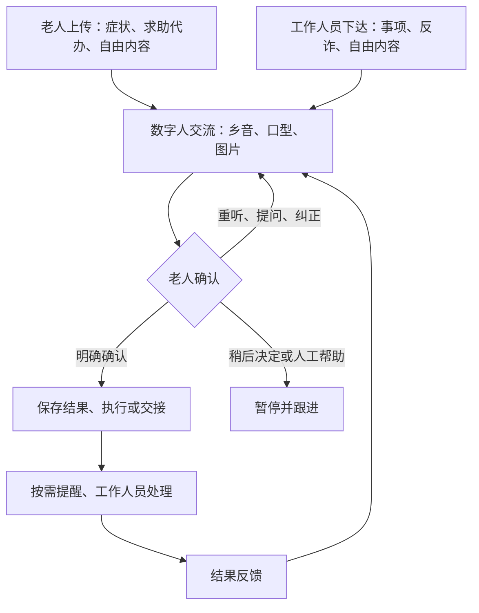

# 老年人数字人双向交流助手：需求框架

状态：需求整理稿，尚未开始新功能实现。

本文件依据现有 PROJECT.md、AGENTS.md、README.md 及本次用户要求整理。项目名称暂未确定；目录名不是最终产品名。本次不修改上述文件、业务代码或运行配置，不安装依赖、不接 API。

## 1. 已经确定的需求

- 上传方向：老人向工作人员描述症状、提出求助与代办申请、表达自由内容。
- 下达方向：工作人员向老人发布指令与代办事项、反诈宣传、自由内容。
- 两条流程以数字人交流为核心，乡音、同步口型、图片共同辅助理解；大字字幕和按钮提供补充操作。
- 老人可重听、提问、纠正、稍后决定或请求人工帮助。
- 明确确认后保存正式结果，按需提醒，工作人员处理并反馈。
- 从老人主动发起的对话中发现乡音词句，经过确认与授权后保存并复用。
- 未回应不等于同意；确认收到不等于完成；提交请求不等于办理成功。
- 症状原话与系统整理内容分开，不自动诊断或提供用药建议。
- 原型使用虚构数据。数字人、方言、图片及可靠提醒尚未实现，不能以占位效果代替能力验证。

## 2. 用户角色与使用场景

| 角色 | 操作与责任 | 典型场景 |
|---|---|---|
| 老人 | 描述、询问、纠正、确认、选择及求助 | 说出身体不适；申请陪同；确认安排；理解安全信息 |
| 工作人员 | 发布与审核内容、接收请求、处理和反馈 | 发布领取通知；回应生活需求；下发反诈材料 |
| 机构负责人 | 确定接手人员、权限、设备与服务规则 | 安排试点，确保请求有人处理 |

目标客户建议：养老院或社区日间照料中心的运营机构。具体首批场所、老人适用条件和付费方待决定，不假定所有老人都适用。

## 3. 系统主线

## 4. 上传流程：老人到工作人员

| 步骤 | 输入 | 系统输出 | 确认规则 |
|---|---|---|---|
| 1. 开始交流 | 老人选择类型或自由讲述 | 显示正在聆听及本次用途 | 不默认常驻监听；语音采集须有明确启动方式 |
| 2. 理解与追问 | 原话、识别文本、老人补充 | 候选摘要、必要问题与图片 | 不确定就询问；不把识别猜测变成事实 |
| 3. 多模态解释 | 候选内容 | 乡音复述、同步口型、图片和字幕 | 可重听、改述、纠正；图片须与内容对应 |
| 4. 最终确认 | 老人明确回应 | 最终内容卡及接收对象 | 展示原话和整理内容的区别；老人可修改或暂缓 |
| 5. 保存与提交 | 经确认的内容 | 正式请求、接收状态 | 成功存储后才报告成功；未确认内容不提交为正式请求 |
| 6. 工作人员处理 | 请求、补充信息 | 已收到、处理进展或回复 | 状态来自真实操作；未知结果不得编造 |
| 7. 反馈与提醒 | 工作人员回复、约定提醒 | 可视化反馈及老人回应 | 提醒触发与老人确认收到分开；变更内容重新确认 |

症状描述示例：选择部位图 → 讲述不适 → 补充时间和影响 → 确认原话与摘要 → 转工作人员。图片用于定位，不用于诊断。

求助代办示例：申请联系工作人员、领取物品或修改安排 → 确认具体需求与时间 → 提交待办 → 返回处理进展。没有实际执行能力时仅提交申请。

自由内容保留老人表达，不强行归入症状或代办。接收范围和处理规则由机构明确。

## 5. 下达流程：工作人员到老人

| 步骤 | 输入 | 系统输出 | 确认规则 |
|---|---|---|---|
| 1. 创建内容 | 类型、文字、图片、对象、时间、选项 | 待审核内容 | 标明要告知、要选择还是需要提交申请 |
| 2. 审核发布 | 工作人员检查事实 | 已发布事项及版本 | 审核后发布；不能由模型补造地点、费用或规则 |
| 3. 向老人解释 | 发布内容和个人偏好 | 乡音、口型、图片、字幕 | 分段呈现；说明系统身份；可暂停、重听和转人工 |
| 4. 回答与修正 | 老人问题、纠正或顾虑 | 基于资料的回答与明确选项 | 资料没有的答案转人工；不通过诱导获得同意 |
| 5. 最终确认 | 老人确认、选择或拒绝 | 确认卡 | 明确区分收到、接受安排、选择结果；沉默不算确认 |
| 6. 保存或执行 | 经确认的回应 | 状态记录、申请或提醒 | 检查工具结果后反馈；可取消或修改 |
| 7. 跟进 | 未回应、求助、事项变更 | 工作人员待办及再次解释 | 不无限催促；关键变更使旧确认需要重新核对 |

反诈宣传仅发布经审核的内容。首版解释风险点并确认收到；互动演练属于拟议扩展，未经用户确认不自动扩大范围。表情与口音不能作为判断诈骗的依据。

自由内容由工作人员输入并审核，指定希望老人确认什么。对无须选择的宣传，不强行要求接受观点或报名。

## 6. 共用确认、乡音和数据规则

### 确认方式

依次核对内容、选择、下一步动作，仅在有必要时追加确认。老人可以直接按按钮或用明确语音回应；语音有歧义时展示卡片再次确认。拒绝、稍后决定、求助是有效回应，不算系统失败。

理解困难时提供不同方式，不机械重复：重播解决听漏，改述解决意思不明，图片帮助定位与说明，人工处理系统无法回答的问题。关键事实始终有清晰文字，不能只靠表情或乡音。

### 乡音采集与复用

主动对话 → 发现候选词句 → 确认文字、含义、情境 → 单独确认是否保存 → 仅在适用情境复用。默认个人使用，不代表地区标准。可查看、纠正、删除及关闭学习。

词句学习、方言识别、方言语音合成是三个不同能力。少量对话不会自动产生可靠方言音色，不将词句采集等同于声音克隆。

### 状态与存储

正式状态至少区分：待回应、已确认收到、已选择或接受安排、稍后决定、需要帮助、待处理、处理中、已回复、已完成、已取消。正式结果以明确确认及真实处理记录为依据。

对话进行中的临时文本与正式提交记录分开。原始录音是否保存、保存时长与访问人员待决定，不能默认长期留存。个人提醒与请求的修改需保留可追踪记录。

## 7. 首版范围（建议，待用户确认）

| 模块 | 首版建议 | 后续扩展 |
|---|---|---|
| 上传 | 三类入口；描述、追问、预览、确认和人工交接 | 更丰富的机构业务接口 |
| 下达 | 三类入口；工作人员提供文字和图片；解释、选择、确认 | 多步骤复杂事项 |
| 数字人 | 一个角色、口型同步、聆听与说话状态、打断 | 实测支持的情绪及关键动作 |
| 乡音 | 一种经验证的方言方案；个人词句确认保存 | 多地区语料及更广音色 |
| 图片 | 工作人员审核的图片、简单部位与选项图 | 经审核的更多视觉素材 |
| 提醒 | 单次提醒、修改取消、收到确认 | 重复提醒与多终端通知 |
| 反馈 | 工作人员收到、处理、回复；老人查看反馈 | 多岗位协同及统计 |

功能范围不包含自动诊断、用药决策、真实支付、默认声音克隆、自动向家人开放全部对话。自由内容不自动授予外部代办权限。

首版通过标准：能演示一条上传、一条下达、一次纠正与一次打断、一次真实状态反馈及一次提醒；未确认不执行，失败如实提示；系统不懂时可转人工。数字人的增益通过与语音、字幕、图片版本对比观察，不预设结论。

## 8. 必须先验证的能力（本阶段只列清单）

| 能力 | 后续验证方法 | 需要得到的结论 |
|---|---|---|
| 魔珐 SDK | 最小独立页面验证加载、播报、同步、停止、状态回调 | 能否稳定完成交流；可控能力有哪些 |
| 口型 | 不同词句、速度与音色下人工观察及目标用户试用 | 是否有用，不以同步等同准确读唇 |
| 方言合成 | 查可用音色并由母语者试听 | 方言是否自然，是否在账号权限内 |
| 方言识别 | 经授权的老人测试语句，包含停顿和普通话混说 | 错误类型和澄清方式 |
| 外部音频驱动 | 仅在平台内音色不满足时检查接入方式 | 外部方言音频能否同步驱动口型；不能默认兼容 |
| 图片与字幕同步 | 检查 SDK 或页面展示能力及打断后的行为 | 旧图片、字幕不会造成新内容误解 |
| 语音轮流交流 | 检查停顿、打断和自身播报回声 | 不频繁抢话，不误识别自身声音 |
| 提醒运行环境 | 页面关闭、设备休眠、断网、服务重启后测试 | 能保证什么条件；失败怎样交接 |

如果方言能力无法满足需求，应向用户说明并决定是否先用普通话，不擅自用假方言或不同步口型替代。

## 9. 分阶段开发顺序

1. 需求定稿：确认名称、场所、输入方式、方言和首版范围。产出批准的流程与验收标准。
2. 能力验证：单独验证 SDK、语音、方言、口型及图片。记录成功、限制和替代方案。
3. 交互设计：设计老人端、工作人员端及确认卡；走读上传、下达各一条场景。
4. 最小下达链路：审核发布 → 数字人解释 → 明确确认或选择 → 保存结果。
5. 最小上传链路：老人讲述 → 追问与图片 → 确认 → 工作人员接收回复。
6. 闭环完善：提醒、状态查询、事项变更、取消及人工求助。
7. 个性化完善：乡音授权、保存、复用、纠正和删除；交流偏好。
8. 场景扩展与试用：反诈和自由内容、异常处理、可部署材料、演示与用户反馈。

以上是后续计划，不是当前执行授权。本阶段仅产出本需求文档。

## 10. 待用户决定的问题

| 问题 | 建议起点，非已确定决定 |
|---|---|
| 最终名称及新项目目录 | 等用户选择，暂不重建或移动 |
| 首批场所 | 选择能找到工作人员与老人试用的单个机构 |
| 首版老人群体与能力条件 | 能通过屏幕、图片、语音或按钮自主表达的用户 |
| 方言是否首版必需及哪一种 | 按本次要求保留，具体种类和降级方式待决定 |
| 老人输入方式 | 语音为主，大按钮辅助；先验证识别能力 |
| 设备 | 保持运行的平板作为试点，个人手机随后考虑 |
| 下达的代办是什么意思 | 区分工作人员发布安排、让老人授权申请、实际外部代办 |
| 提醒规则 | 单次为起点；频率、无人回应时跟进人待决定 |
| 人工接手和不适反馈 | 由机构指定负责人和接手流程，AI 不承担诊断或急救判断 |
| 自由内容边界 | 谁接收、如何转交、哪些请求不能执行 |
| 原话、录音与图片留存 | 必要数据、期限、权限及授权方式待确定 |
| 反诈形式 | 首版宣传解释还是互动演练 |

## 11. 现有原型与目标需求的区别

README.md 说明现有原型采用网页和 SQLite，实现文字发布、预览提交、回应与工作人员回复，以及浏览器朗读。它还没有真实数字人、图片配置、身份认证或可靠后台提醒。

该原型只能参考业务记录流转，不作为最终交互设计。其存在不代表上述建议、技术栈或产品名已经定稿。本次保持原型及现有说明文件不变。
